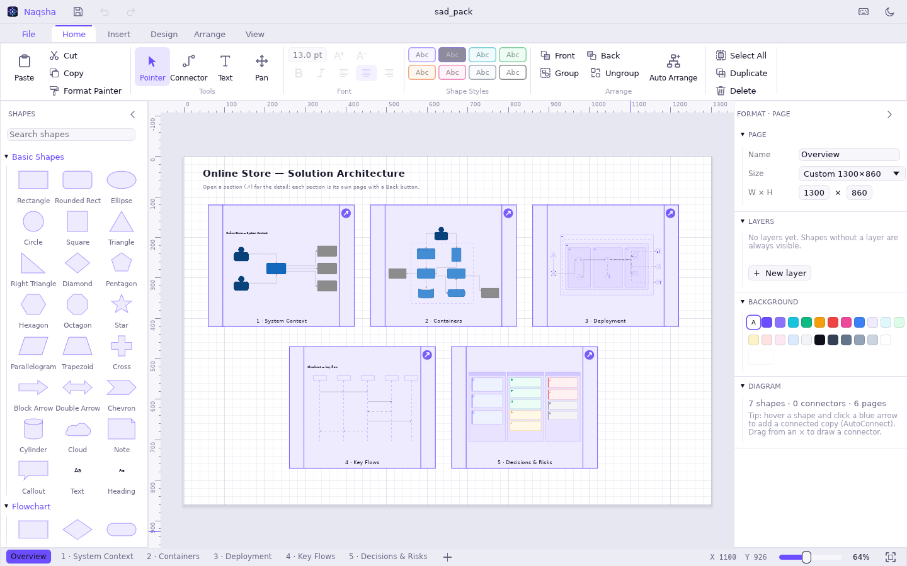
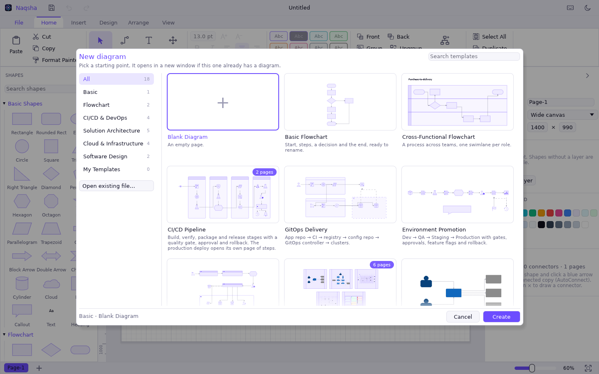
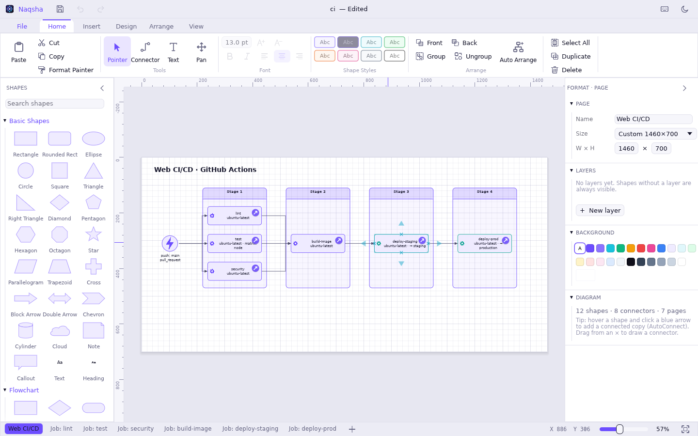

<div align="center">


# Naqsha

**Diagramming and architecture for macOS, Windows, Linux and the browser: flowcharts, cloud and solution architecture, CI/CD pipelines, Visio and draw.io files.**

*naqsha* (نقشه): a plan, a map, a blueprint.

[Download](../../releases/latest) · [Open in browser](https://nixpx.com/naqsha/app) · [Build from source](#build-from-source) · [Features](#features) · [File formats](#open-and-save-any-format) · [Roadmap](#roadmap)


<picture>
  <source media="(prefers-color-scheme: dark)" srcset="docs/images/hero-dark.png">
  
</picture>

</div>

---

## Why Naqsha

- **A real desktop app.** It's GPU-rendered and starts instantly, on macOS, Windows and Linux. On the Mac it has a native menu bar and opens files from Finder. It works offline. Your diagrams are plain files on your disk, not rows in someone else's cloud.
- **It speaks Visio and draw.io.** Open a `.vsdx` from a colleague, edit it, and send back a `.vsdx`. The same goes for `.drawio`, with pages, layers, containers, shape data and connector routes kept.
- **Built for architects and DevOps engineers.** It comes with C4, cloud and enterprise-integration stencils, and with templates for solution architecture packs, GitOps and environment promotion. It also imports GitHub Actions, GitLab CI, Azure Pipelines, Bitbucket Pipelines and Jenkins definitions straight into diagrams.
- **Large systems stay readable.** Any shape can open its own page (a sub-diagram) and shows a live preview of it, so an overview stays clean while the detail is one click away.

## Features

<table>
<tr>
<td width="50%" valign="top">

**Drawing**
- 180 shapes in 10 searchable stencil groups: basic, flowchart, network, UML and data, containers and swimlanes, cloud infrastructure, cloud zones, enterprise integration, CI/CD and DevOps, architecture artifacts (C4, ADRs, risks, requirements)
- Your own SVG icon folders as stencils, e.g. a cloud vendor's official icon pack
- Right-angle, straight and curved connectors with glue, AutoConnect, line jumps and routing around shapes
- Drag any connector segment to reroute it by hand
- Auto Arrange: layered top-down or left-to-right, grid, containers and swimlanes

</td>
<td width="50%" valign="top">

**Organising**
- Multiple pages, layers, groups, containers and swimlanes
- Sub-diagrams with live previews, breadcrumbs and Back (⌘↑)
- Shape data (key/value fields) on any shape or connector
- Themes, quick styles, Format Painter, light and dark mode. Text stays readable on any fill.
- Multiple windows, one per diagram
- Crash recovery and an unsaved-changes prompt

</td>
</tr>
</table>

### Start from a template



18 built-in templates. You can also save your own diagrams as templates (File › Save as Template).

| Category | Templates |
|---|---|
| Solution architecture | Solution Architecture Pack (overview with 5 linked pages) · C4 System Context · C4 Containers · Decisions, Risks & Requirements · Enterprise Integration |
| Cloud & infrastructure | Three-Tier Web App · Microservices & Events · Data Platform · Network & Security Zones |
| CI/CD & DevOps | CI/CD Pipeline · GitOps Delivery · Environment Promotion · Infrastructure as Code |
| Software design | Sequence Diagram · Data Model (ER) |
| Flowchart | Basic Flowchart · Cross-Functional (swimlanes) · Blank |

### Turn a pipeline file into a diagram



Open or drop a CI/CD definition and Naqsha draws it:
- The trigger comes first, then jobs in stage columns, ordered by `needs`, `dependsOn` or `stage`.
- Matrix builds, environments and manual approvals are labelled on the jobs.
- Each job opens a page of its steps, with `run:` scripts shown as code.

| Supported definitions |
|---|
| GitHub Actions (`.github/workflows/*.yml`) · GitLab CI (`.gitlab-ci.yml`) · Azure Pipelines (`azure-pipelines.yml`) · Bitbucket Pipelines (`bitbucket-pipelines.yml`) · Jenkins (`Jenkinsfile`, declarative) |

## Open and save any format

| Format | Open | Save | What's kept |
|---|:---:|:---:|---|
| Naqsha `.nqs` | ✓ | ✓ | Everything. Plain JSON, so it diffs well in git. Older `.schx` files open too. |
| Microsoft Visio `.vsdx` | ✓ | ✓ | Masters, styles, groups, rotation and flip, text blocks, layers, shape data, glued connectors, pictures, page links |
| draw.io / diagrams.net `.drawio` | ✓ | ✓ | Pages, layers, containers, HTML labels, label positions, data, waypoints, page links. Both compressed and plain files. |
| SVG | ✓ | ✓ | Paths become editable shapes, text becomes text, embedded images become pictures |
| PNG · PDF | — | ✓ | Vector PDF. Sub-diagram previews are included. |

Legacy binary Visio files (`.vsd`) aren't supported; re-save them as `.vsdx` in Visio.

## Install

Get the latest version from **[Releases](../../releases/latest)**:

| System | Download | Notes |
|---|---|---|
| macOS 11+ (Apple Silicon and Intel) | `Naqsha-…-macos-universal.dmg` | Open it and drag **Naqsha** to Applications |
| Windows 10 / 11 (x64) | `Naqsha-…-windows-x64-setup.exe` | Installs for your user, no admin needed. Also a portable `.zip`. |
| Ubuntu / Debian | `naqsha_…_amd64.deb` | `sudo apt install ./naqsha_*_amd64.deb` |
| Red Hat / Fedora / Rocky / Alma | `naqsha-…x86_64.rpm` | `sudo dnf install ./naqsha-*.x86_64.rpm` |
| Other Linux (x86_64) | `naqsha-…-linux-x86_64.tar.gz` | Unpack and run `./naqsha` |
| Any modern browser | **[nixpx.com/naqsha/app](https://nixpx.com/naqsha/app)** | Nothing to install. Save downloads a `.nqs`; unsaved work is kept in the browser. |

The Linux build runs on Ubuntu 20.04+, Debian 11+, RHEL 8+ and recent Fedora, on X11 or Wayland. File dialogs use the desktop portal (`xdg-desktop-portal`), which GNOME and KDE already have.

The macOS and Windows builds aren't code-signed yet. On a Mac, right-click Naqsha › Open the first time. On Windows, choose More info › Run anyway if SmartScreen warns you.

### Build from source
Install Rust from [rustup.rs](https://rustup.rs), then:

```bash
cargo build --release                     # any OS: target/release/naqsha(.exe)
./build-mac.sh --install                  # macOS: Naqsha.app + .dmg (universal), installed into /Applications
./build-web.sh                            # browser: dist/web (+ dist/naqsha-web.zip), static files for any web server
```
The browser build needs `rustup target add wasm32-unknown-unknown` and `cargo install wasm-bindgen-cli` at the version in `Cargo.lock`; `wasm-opt` (binaryen) makes it smaller. Serve `dist/web` as static files from any path. It needs no backend.
On macOS, add `--native` for a faster build for your Mac only. To distribute the Mac app, set `SIGN_IDENTITY="Developer ID Application: …"` and notarize.

Pushing a `v*` tag runs `.github/workflows/release.yml`, which builds every package above and publishes them as a GitHub Release.

## Keyboard shortcuts

Shown with Mac keys. On Windows and Linux, ⌘ is Ctrl, ⌥ is Alt and ⇧ is Shift; the app shows the right names for your system.

| Action | Keys | Action | Keys |
|---|---|---|---|
| New (template gallery) | ⌘N | Auto Arrange | ⇧⌘L |
| Open / Save | ⌘O / ⌘S | Light / dark | ⇧⌘D |
| Pointer · Connector · Text · Pan | V · C · T · H | Open sub-diagram / Back | ⌘↓ / ⌘↑ |
| Duplicate | ⌘D or ⌥-drag | Group / Ungroup | ⌘G / ⇧⌘G |
| Edit text | Double-click, or just type | Front / Back | ⇧⌘] / ⇧⌘[ |
| Fit page / 100% | ⌘1 / ⌘0 | Lock | ⌘L |
| Cancel a drag, close a menu | Esc | All shortcuts | Help menu |

## Command line

```bash
naqsha --export in.vsdx out.drawio          # convert between .nqs, .vsdx, .drawio
naqsha --export in.nqs out.pdf 2 --dark      # page 2 as PDF / PNG / SVG, optionally dark
naqsha --export .github/workflows/ci.yml ci.png
naqsha --arrange lr in.drawio out.nqs        # auto-arrange: tb | lr | grid
naqsha --templates ./out                     # write every built-in template as .nqs
```

## Roadmap

- Open files from a URL in the browser version, and your own templates there
- Comments and review mode
- Visio stencil files (`.vssx`) as shape libraries
- Data-linked shapes (CSV / JSON)

Ideas and bug reports are welcome in [Issues](../../issues).

## Contributing

```bash
cargo test --release      # 30 tests: formats, routing, layout, sub-diagrams, pipelines, templates
cargo run --release       # run the app
```

<details>
<summary>Project layout</summary>

```
src/main.rs        startup, CLI, per-window frame
src/shell.rs       multiple windows
src/app.rs         application state, documents, undo, files
src/model.rs       document model (pages, shapes, connectors), serde JSON
src/canvas.rs      canvas interaction: select, move, resize, connect, edit routes
src/render.rs      drawing shapes and connectors; readable text colours
src/geom.rs        transforms, connection points, connector routing
src/route.rs       obstacle-avoiding routing, route clean-up, line jumps
src/layout.rs      Auto Arrange
src/subpage.rs     sub-diagrams and navigation
src/templates.rs   built-in templates
src/library.rs     stencils and shape geometry
src/userlib.rs     SVG stencil folders
src/ui.rs          ribbon, panels, format pane, dialogs, shortcuts
src/export.rs      SVG / PNG / PDF export
src/formats/       vsdx.rs · drawio.rs · svgin.rs · pipeline.rs
src/macos.rs       native menu bar, Finder integration
src/platform.rs    per-OS glue: shortcut names, data folders
src/files.rs       file dialogs and saving; the browser's file picker, downloads and tabs
assets/            icon.svg (source), Naqsha.icns
linux/  windows/   desktop entry, file types, installer
web/               the browser page (index.html) and its fonts
examples/          sample.nqs, make_icon.rs, render_svg.rs
```
</details>

## Formerly Schemix

Naqsha was called Schemix during early development. Older `.schx` files open as normal. Your settings, recent files and saved templates move over automatically the first time Naqsha starts.

## License

[MIT](LICENSE) © 2026 Nixpx LLC

<div align="center"><sub>Made by <a href="https://nixpx.com">Nixpx</a></sub></div>
